<!--
  README.md is GENERATED from this template, so that no measured number is typed by hand.
  Edit this file, then run:   python scripts/render_readme.py
-->

<h1 align="center">PixelProof</h1>

<p align="center">
  <b>Prove where every pixel came from, and say honestly what it shows.</b><br>
  Provenance, integrity verification and post-capture manipulation detection for Earth-observation imagery.
</p>

<p align="center">
  
  
  
  
  
</p>

<p align="center">
  <a href="#quick-start">Quick start</a> ·
  <a href="#how-it-works">How it works</a> ·
  <a href="#results">Results</a> ·
  <a href="#attack-labs">Attack labs</a> ·
  <a href="#reproduce-every-number">Reproduce</a> ·
  <a href="docs/latex/PixelProof_Phase1_Report.pdf">Full report (PDF)</a>
</p>

<p align="center">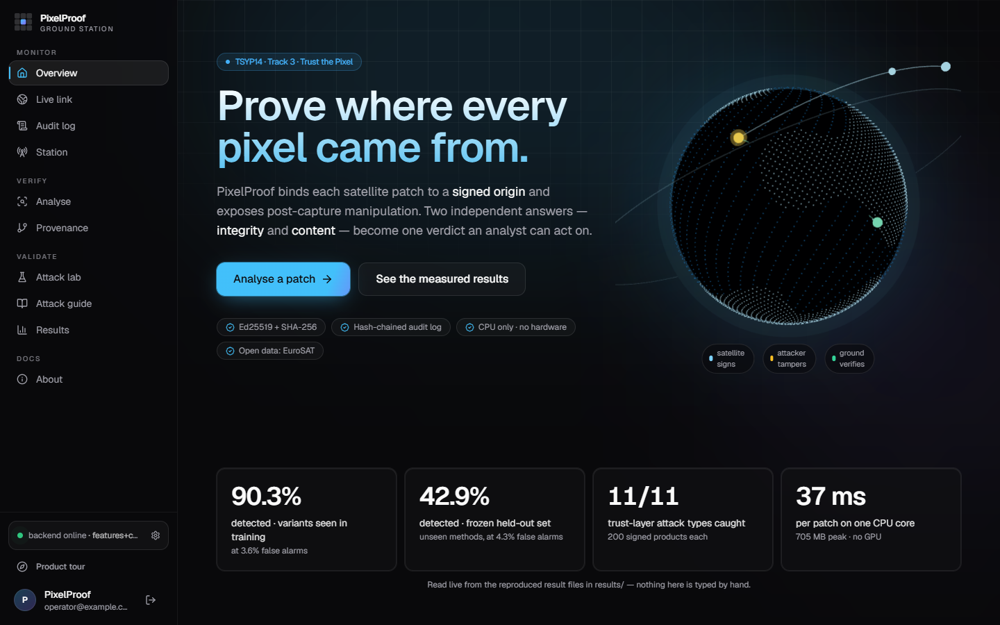</p>

---

## What is PixelProof?

An analyst receives a satellite image patch and has to decide whether to act on it. Two different questions hide in that
decision, and most tools answer only one of them, or blur them together:

| | Question | How PixelProof answers | Nature of the answer |
|---|---|---|---|
| **Integrity** | Is this exactly what a trusted source produced, with the stated date and origin, untouched since? | SHA-256 digest of the pixels, an Ed25519-signed capture claim, a signed and linked record of every processing step, pinned algorithms, replay protection | **Proof** |
| **Content** | Does the picture itself carry traces of resampling, splicing, copy-move, or generated / inpainted regions? | 48 explainable forensic features feeding a gradient-boosted classifier, fused with a small forensic CNN; threshold calibrated for a fixed false-alarm budget | **Evidence**, never "authentic", only "no traces found" |

> [!IMPORTANT]
> **A signature proves who signed and that nothing changed afterwards. It does not prove the picture is true.**
> A compromised source can sign a fake. PixelProof therefore keeps the two answers on **two independent axes**, combines
> them in one verdict, and quarantines anything doubtful instead of releasing it silently.

It is built for the TSYP14 technical challenge *Ground Truth Under Attack: Securing the Earth Observation Chain*
(**Track 3, Trust the Pixel**) and works on authentic public data (EuroSAT, Sentinel-2). Everything is software, runs on a
laptop CPU, and needs no GPU, cloud service or purchased hardware.

### Design principles

1. **Provenance first.** A learned detector degrades on manipulations it has never seen; a signature does not. Proof carries the guarantee, forensics adds evidence on top.
2. **Two answers, kept apart.** Integrity and content are reported separately and read together, never merged into one score.
3. **Fail closed.** Any verdict other than `VERIFIED` or `UNVERIFIED_NO_TRACES` is quarantined (kept, withheld downstream, released only by a logged analyst decision).
4. **Honest wording.** The detector says "manipulation found (type)" or "no traces found". It never says "authentic".
5. **Explainable and auditable.** Every alarm lists the features that fired and a heatmap; every decision goes into a hash-chained audit log.
6. **Local and cheap.** One CPU core, no cloud, an emulated or software trust anchor, with an upgrade path to SoftHSM2 or a TPM.
7. **Measured, not claimed.** Every number comes from a result file; weak spots are reported next to the strengths.

## Results at a glance

Shipped model (feature model + CNN fused), EuroSAT RGB, thresholds fixed on validation data and never tuned on test data.

| What we measured | Result |
|---|---|
| Manipulations **seen** in training | **90.3%** detected at **3.6%** false alarms (AUC 0.972) |
| **Held-out** manipulations never seen in training | **48.2%** at 4.4% false alarms (AUC 0.793) |
| **Frozen held-out v2** (SHA-256 recorded before any change) | **42.9%** at 4.3% false alarms (AUC 0.855) |
| Trust layer: 11 attack types against 200 signed products each | every attack returns its expected status |
| Transparent man-in-the-middle (Docker) | 16/16 cryptographic attacks stopped; the satellite's own packet capture never shows the attacker |
| Cost of one decision (one CPU core) | 36.7 ms per patch; sign 0.25 ms, verify 0.38 ms |

The gap between *seen* and *held-out* is the honest headline: detectors lose ground on manipulations they were not
trained on, which is exactly why the integrity axis carries the guarantee. Details, weak spots and the full tables are in
[Results](#results) and in the [report](docs/latex/PixelProof_Phase1_Report.pdf).

## Contents

- [How it works](#how-it-works): architecture, trust layer, content detector, verdict
- [Operator dashboard](#operator-dashboard): sign-in, overview, live link, audit log, station, analyse, provenance, attack lab
- [Data and manipulation plan](#data-and-manipulation-plan)
- [Threat model](#threat-model)
- [Results](#results)
- [Quick start](#quick-start)
- [Attack labs](#attack-labs)
- [Reproduce every number](#reproduce-every-number)
- [API](#api)
- [Repository layout](#repository-layout)
- [Business model and potential partners](#business-model-and-potential-partners)
- [Limitations and roadmap](#limitations-and-roadmap)
- [References, licence and data](#references-licence-and-data)

---

## How it works

PixelProof reproduces the three roles of the challenge as separate programs that talk over HTTP, so the same code runs on
one laptop, in three containers, or on separate virtual machines.

<p align="center">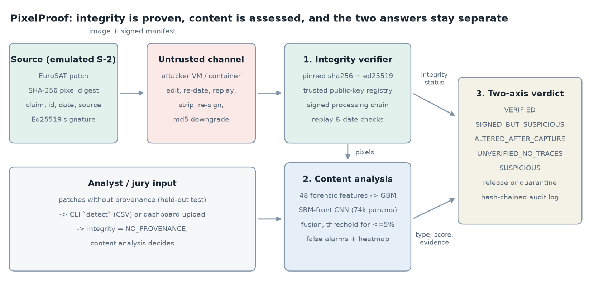</p>

The source signs; the channel is untrusted and may attack; the ground station verifies integrity and, in parallel, analyses the
content; the two answers are combined into one verdict, released or quarantined, and logged. Imagery that arrives without
provenance (an analyst upload or a jury patch) skips the integrity proof and goes straight to content analysis.

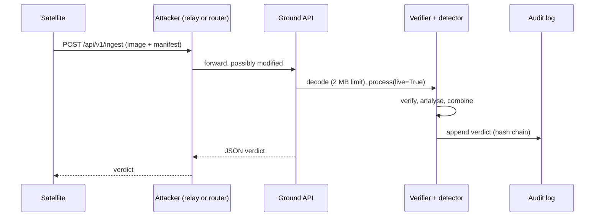

### 1. The trust layer (integrity axis)

| Element | What it is |
|---|---|
| **Digest** | `SHA-256("PXP1" \| dtype \| shape \| raw pixel bytes)`. Computed over pixels, not the file, so the claim survives a lossless re-save and breaks on a single flipped bit. |
| **Signed claim** | Product id, source, sensor, capture time, bands, shape, dtype, pixel digest, algorithm names, key id, sequence number and previous hash, as canonical JSON signed with the source's Ed25519 key. |
| **Processing chain** | Each processing step records its operation, parameters, input and output digest, and a link to the previous record, signed by a registered *processor* key. The final digest must equal the digest of the pixels received. |
| **Trust anchor** | A software keystore (private keys outside the repository, mode 0600). The ground station holds only a registry of **public** keys with roles and revocation flags; a key arriving inside a message is never trusted. Fingerprints are compared out of band (`python -m pixelproof.cli fingerprints`). |
| **Replay memory** | Product ids and per-source sequence numbers are remembered and **rebuilt from the audit log after a restart**, so a reboot does not reopen the replay window. |
| **Audit log** | Append-only JSON lines; each entry carries the hash of the previous one. Editing or deleting any past entry turns the dashboard badge to `BROKEN` and names the first bad line. Tamper-evident, not tamper-proof. |

The verifier runs these checks in order and the **first failure decides the status**. Algorithms are pinned *before* any
digest is compared, so a downgraded `md5` claim never reaches the comparison.

| # | Check | Status on failure |
|---|---|---|
| 1 | manifest present | `NO_PROVENANCE` |
| 2 | required fields and format | `MALFORMED` |
| 3 | only `sha256` + `ed25519` claimed | `WEAK_ALGORITHM` |
| 4 | signing key in the registry and not revoked | `UNKNOWN_KEY` / `REVOKED_KEY` |
| 5 | claim signature valid | `BAD_SIGNATURE` |
| 6 | every processing step signed and linked | `CHAIN_BROKEN` |
| 7 | received pixels hash to the last signed digest | `PIXELS_ALTERED` |
| 8 | capture date possible | `TIME_IMPLAUSIBLE` |
| 9 | new product, increasing sequence number | `REPLAY` |
| | all checks passed | `VERIFIED` |

### 2. The content detector (evidence axis)

Six feature families, each tied to a physical trace of editing (`pixelproof/features.py`, 48 features in total):

| Family | Trace it looks for |
|---|---|
| **Resampling** `rs_*` | Interpolation makes each pixel a fixed linear combination of its neighbours, leaving *periodic* correlations (second-derivative spectrum, Popescu-Farid probability map). |
| **Frequency profile** `fq_*` | Inpainting and generation remove high frequencies; local edits disturb the 8x8 JPEG block grid. |
| **Noise residual** `nz_*` | An SRM high-pass residual: edited regions are "too smooth" or inconsistent with the sensor noise of the rest of the patch. |
| **Channel coherence** `cc_*` | Real sensor and demosaicing noise is correlated across R, G, B; pasted or synthesised regions break that. |
| **Colour statistics** `cs_*` | Spliced regions whose chroma or local noise level does not match the host, even with a feathered seam. |
| **Copy-move** `cm_*` | DCT block matching, canonicalised over the 8 rotations and reflections (D4), so rotated and mirrored copies are found; textureless blocks are skipped. |

A **PixelNet** CNN (74,116 parameters, CPU only) reads the same patch through a *fixed* SRM high-pass front end, so it looks at
sensor noise instead of scenery. The two models are fused, and the decision threshold is **condition-aware**: a second model
estimates whether the patch was re-compressed after capture, and the threshold moves between two calibrated points so that
re-encoded authentic patches stay near the false-alarm budget. Images of any size and format are cut into 64x64 tiles and
**never resized** (resizing would itself add resampling traces).

Without PyTorch the system still runs with the feature model alone, with its own calibrated threshold.

### 3. One verdict, two axes

| | content: no traces found | content: manipulation found |
|---|---|---|
| **integrity `VERIFIED`** | `VERIFIED` → release | `SIGNED_BUT_SUSPICIOUS` → quarantine *(faked before signing?)* |
| **integrity failed** | `ALTERED_AFTER_CAPTURE` → quarantine | `ALTERED_AFTER_CAPTURE` → quarantine *(+ type, heatmap)* |
| **no provenance** | `UNVERIFIED_NO_TRACES` → release | `SUSPICIOUS` → quarantine *(+ type, heatmap)* |

Each content alarm comes with a manipulation type (resampled / spliced, copy-move, generated / inpainted), the score
against the threshold, the features furthest from the authentic distribution in plain words, and an evidence heatmap.

<p align="center">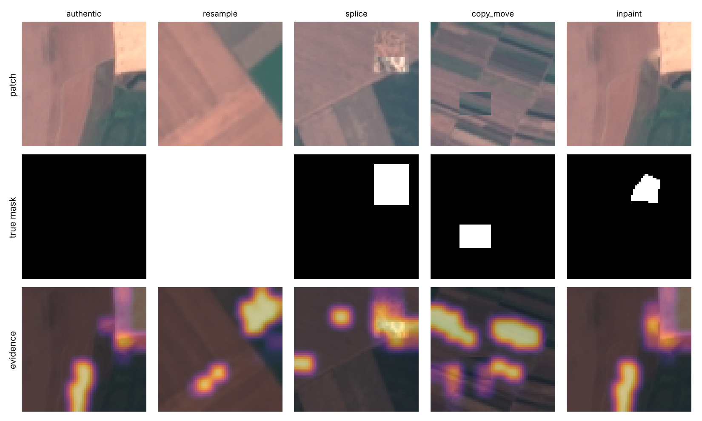</p>

---

## Operator dashboard

A React + TypeScript dashboard (Vite, Tailwind, Three.js) is built into static files that the ground station serves itself, so
running the system needs only Python. It works offline (fonts and the 3-D scene are bundled, no CDN), falls back to a 2-D
diagram without WebGL, and enforces a strict Content-Security-Policy. **Nothing on a page is typed by hand**: counters come from
the audit log and headline figures from the result files. The screenshots below were taken from a running ground station that
had just processed real attacked traffic.

### Sign-in and guided tour

<p align="center"></p>

A ground station shared by several operators needs an access screen. An optional sign-in server (Laravel 12, in `backend/`) provides it;
when it is not running, the dashboard opens in an explicitly labelled *open access* mode.

| Property | How it is provided |
|---|---|
| Tokens | two JWTs (HS256): a short-lived **access token** (15 minutes) and a **refresh token** (7 days) |
| Storage in the browser | `HttpOnly`, `SameSite=Lax` cookies: page scripts cannot read the tokens |
| Request authentication | a middleware copies the access cookie into the `Authorization: Bearer` header on the server side |
| Refresh and rotation | the refresh token is also stored server-side; using it deletes it and issues a new pair, so a stolen refresh token works once |
| Logout | the stored refresh token is deleted, the access token is blacklisted, both cookies are expired |
| Account rules | bcrypt password hashes; login needs a verified e-mail and an active account; login, registration and refresh are rate-limited to 10 requests per minute |

The sign-in protects the **dashboard**, not the ground-station API (see [limitations](#limitations-and-roadmap)); its cookies are not yet flagged `Secure`, which a TLS deployment must set.

A 14-step guided tour opens each page in turn and spotlights its real panel; the layout is responsive down to phone width.

<table>
  <tr>
    <td width="38%" valign="top">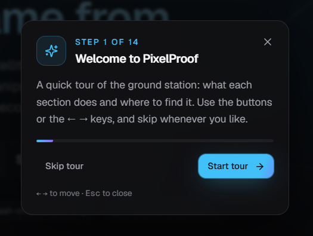</td>
    <td width="40%" valign="top">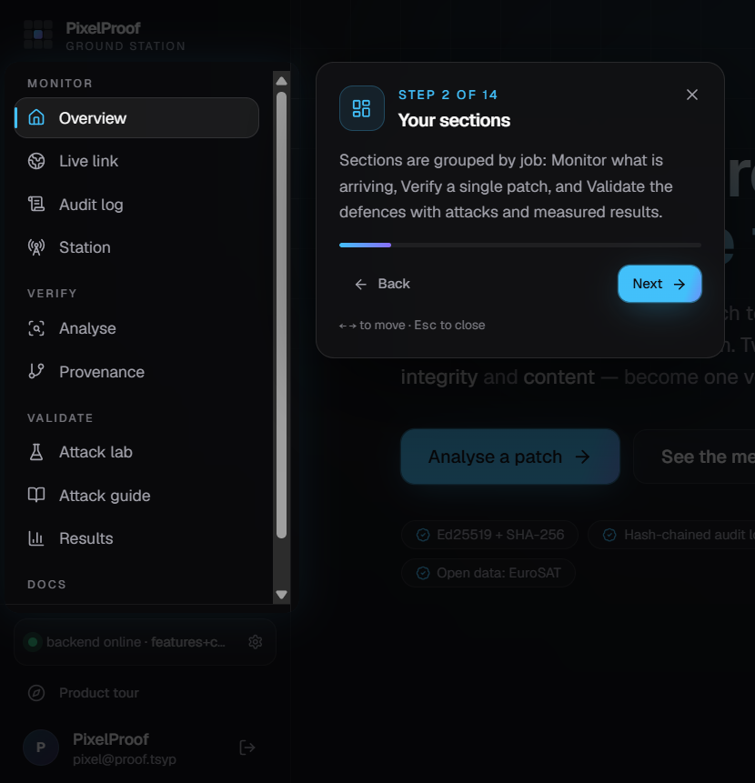</td>
    <td width="22%" valign="top">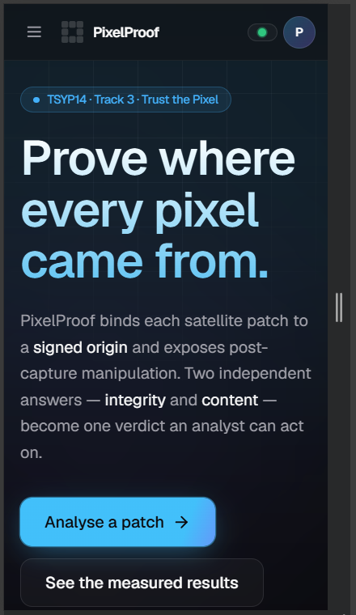</td>
  </tr>
  <tr>
    <td align="center"><sub>Tour, step 1 of 14</sub></td>
    <td align="center"><sub>Tour, step 2: the sections</sub></td>
    <td align="center"><sub>Phone width (320 px)</sub></td>
  </tr>
</table>

### Overview

<p align="center"></p>

The landing page: a 3-D globe of the satellite, attacker and ground link, and the headline figures (detection on seen and frozen
held-out variants, trust-layer campaign, cost per patch) read live from `results/` through `/api/v1/results`.

### Live link and audit log

<table>
  <tr>
    <td width="50%">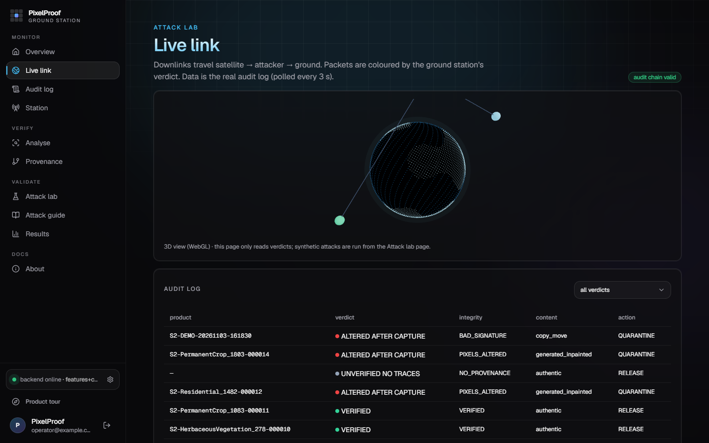</td>
    <td width="50%">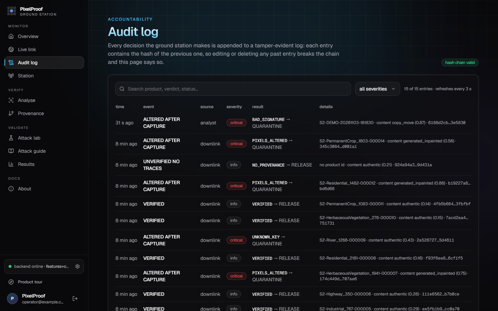</td>
  </tr>
  <tr>
    <td valign="top"><sub><b>Live link.</b> Downlinks travel satellite, attacker, ground; each is coloured by the ground station's verdict. The data is the real audit log, polled every 3 s.</sub></td>
    <td valign="top"><sub><b>Audit log.</b> Every decision, searchable and filterable by severity. The <code>hash chain valid</code> badge is re-verified on every refresh; editing or deleting any past line turns it to <code>BROKEN</code> and names the first bad entry.</sub></td>
  </tr>
</table>

### Station: who is trusted

<p align="center">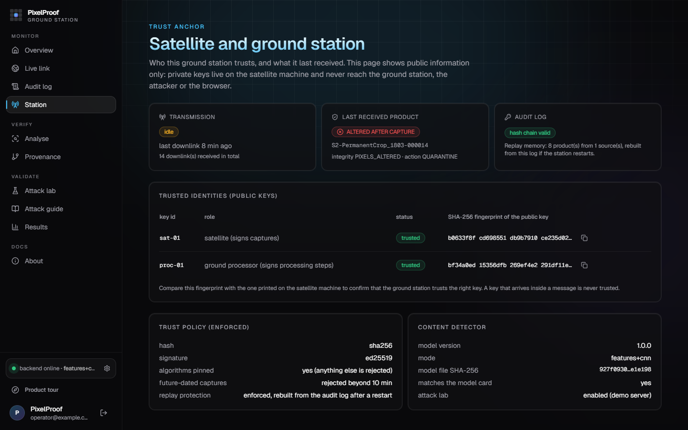</p>

Public information only (private keys never reach the ground station or the browser): the trusted identities with the SHA-256
fingerprint of each public key, to be compared out of band with the one printed on the satellite machine; the enforced trust policy
(algorithms pinned to `sha256` + `ed25519`, captures dated more than 10 minutes in the future rejected, replay memory rebuilt from the audit log after a restart);
and the content detector's mode and **model-file SHA-256, checked against its model card**.

### Analyse: two questions, two panels

<p align="center">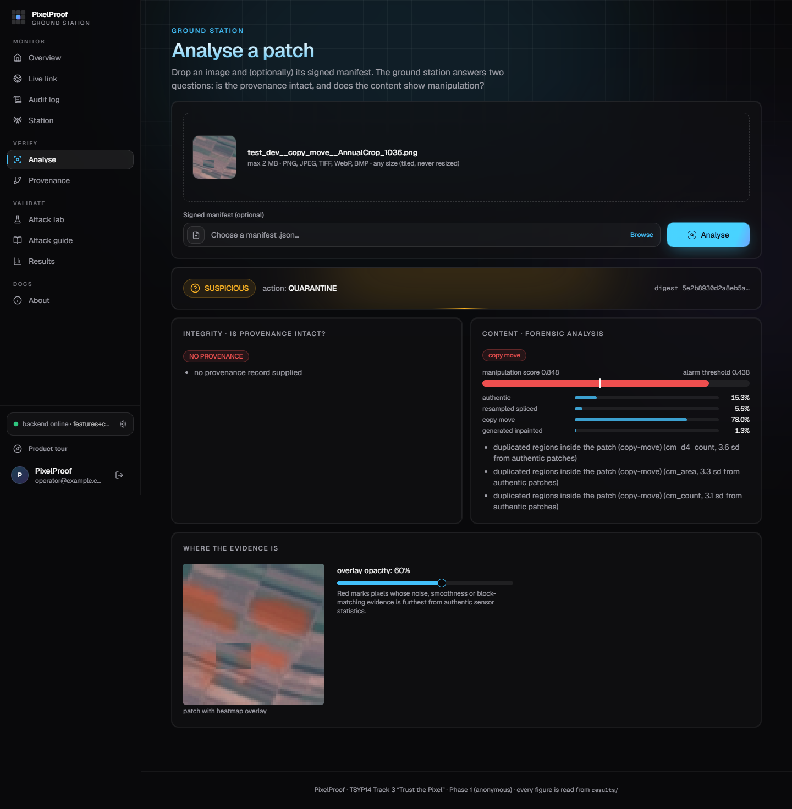</p>

Drop an image and, optionally, its signed manifest. The left panel answers *is the provenance intact?* (here `NO_PROVENANCE`,
because no manifest was supplied); the right panel answers *does the content show manipulation?* with the manipulation score
against the alarm threshold, the class probabilities, the evidence in plain words, and a heatmap overlay with an opacity slider
that marks where. The verdict above them combines both: `SUSPICIOUS`, action `QUARANTINE`.

### Provenance timeline: where the proof breaks

<p align="center">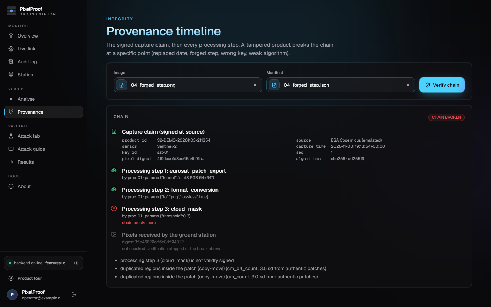</p>

The signed capture claim, then every processing step, as a timeline. This product carries a forged processing step: the claim and
the two genuine steps are green, step 3 is where the chain breaks (`CHAIN_BROKEN`), and the received pixels are marked *not checked*
because verification stops at the first failure. The same page shows the other breaks: a replaced date, a wrong key, a weak algorithm.

### Attack lab and results

<table>
  <tr>
    <td width="50%">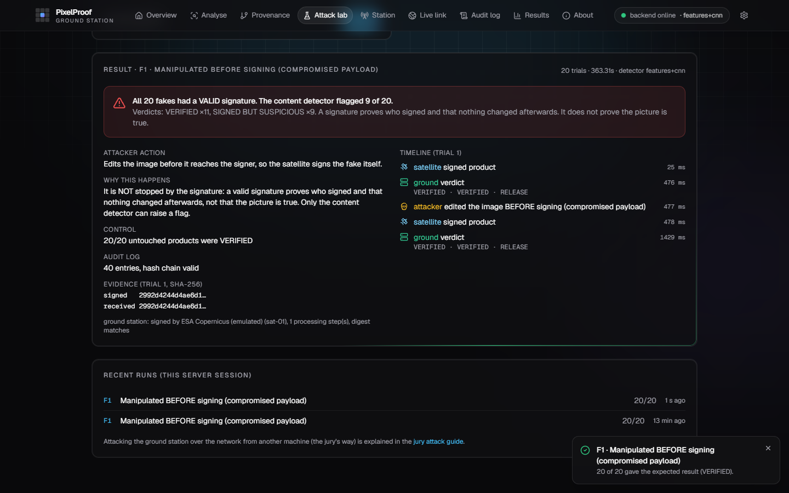</td>
    <td width="50%">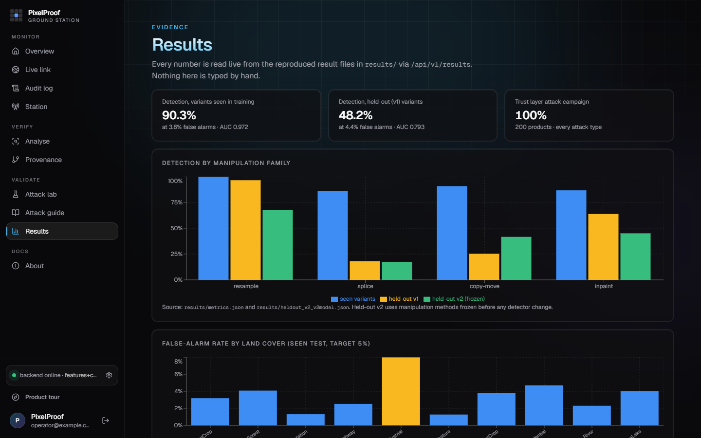</td>
  </tr>
  <tr>
    <td valign="top"><sub><b>Attack lab</b> (off unless <code>PIXELPROOF_LAB_MODE=1</code>). Runs the attack scenarios A to F against the real ground-station code and shows what the attacker did, expected versus actual result, an untouched control, the evidence digests and a timeline. Shown: scenario F1, fakes signed <i>before</i> capture. Every signature is valid; the detector flags only some.</sub></td>
    <td valign="top"><sub><b>Results.</b> Detection by manipulation family for seen, held-out and frozen variants, false alarms by land cover, and the other measured tables, read live from <code>results/</code>.</sub></td>
  </tr>
</table>

The remaining pages are **Attack guide** (a read-only page explaining how to attack the ground station yourself from the attacker machine, with the exact `curl` calls and the status each attack should produce) and **About**.

---

## Data and manipulation plan

**Data.** EuroSAT RGB: 27,000 Sentinel-2 patches of 64x64 pixels in 10 land-cover classes, MIT licence, downloaded by
`scripts/download_eurosat.py`, which refuses data whose class counts differ from the paper. Thirty unmodified official patches ship in
[`samples/`](samples/README.md) so that the labs, tests and demo run without the 2 GB dataset. Nothing private or restricted is used.

**Splits and leakage.** Every official patch is assigned to exactly one split by a SHA-256 hash of its id: train 60%, validation 15%,
test-seen 12.5%, test-held-out 12.5%. For each source patch one authentic and one manipulated copy are rendered, and a patch, its
manipulated copy and its splicing donor always share a split, so there is no leakage. The seen test set holds
6680 patches and the held-out test set 6612. Thresholds and the fusion weight are fixed on validation only.

**Manipulations.** The standard scenario asks for a resampled or spliced image, a copy-move alteration and a generated or inpainted
region. The generators are deterministic and seeded, and they are **different on purpose** between training and testing, so the
held-out numbers measure generalisation rather than memorisation. The satellite and its processing chain are emulated (a Python process
holding two software keys); the pixels, the cryptography, the network attacks and the detector are real.

| Group | Training (seen) | Held-out v1 | Frozen held-out v2 |
|---|---|---|---|
| Resampled / spliced | bilinear x1.15-1.5, rotation 4-12 deg, hard-edged splices | bicubic / Lanczos, x1.6-2.2, rotation 15-35 deg, feathered colour-matched splices | perspective and biquadratic warps; Poisson (seamless-clone) splices with a donor from another land-cover class |
| Copy-move | translated rectangles | rotated, rescaled, noisy polygons | mirrored elliptical region, soft-blended |
| Generated / inpainted | Telea inpainting | Navier-Stokes, biharmonic, texture synthesis | exemplar fill plus injected sensor noise |
| Laundering (all patches) | 1-2 of JPEG, WebP, noise | JPEG 2000 plus radiometric stretch | none |

---

## Threat model

The protected segment is the imagery chain from the moment a Sentinel-2 product leaves its trusted source to the moment an
analyst uses a 64x64 EuroSAT patch derived from it. Radio-link attacks (Track 1) and sensor-level false-data injection
(Track 2) are out of scope by design.

| ID | Attacker | Capability | Control |
|---|---|---|---|
| A1 | Network man-in-the-middle | modify, replay, strip or swap manifests | signature, pixel digest, key registry, sequence numbers |
| A2 | Storage insider | edit pixels or claims, add fake processing | digest re-verification, signed chain, audit log |
| A3 | AI-equipped forger (unsigned imagery) | resample, splice, copy-move, inpaint, re-encode | content detector, 5% false-alarm budget |
| A4 | Adaptive attacker who knows the detector | feathering, colour matching, rotations, laundering | held-out evaluation, laundering-robust training, provenance first |
| A5 | Key thief or compromised payload | signs arbitrary content | revocation; content analysis still runs on signed data |
| A6 | Algorithm substitution | claims md5 or none and recomputes it | algorithm pinning (sha256 + ed25519 only) |

STRIDE is mapped onto the segment in the report: spoofing → `UNKNOWN_KEY`, tampering → `PIXELS_ALTERED`, repudiation → signed
steps and the hash-chained log, information disclosure (LSB embedding) → digest mismatch, denial of service → 2 MB limit,
decode guard, rate limit and quarantine instead of crash, elevation of privilege → `CHAIN_BROKEN`.

---

## Results

All values below are read from `results/*.json` when this README is generated.

### Detection

| Model | Test set | AUC-ROC | Detection | False alarms | 4-class macro-F1 |
|---|---|---|---|---|---|
| Features (GBM) | seen | 0.844 | 60.9% | 4.1% | 0.705 |
| Pixel CNN | seen | 0.959 | 84.9% | 4.1% | 0.852 |
| **Fused** | **seen** | **0.972** | **90.3%** | **3.6%** | **0.903** |
| Features (GBM) | held-out | 0.687 | 29.5% | 4.7% | 0.398 |
| Pixel CNN | held-out | 0.780 | 46.1% | 3.9% | 0.522 |
| **Fused** | **held-out** | **0.793** | **48.2%** | **4.4%** | **0.528** |

*Seen* variants appear in training; *held-out* variants use different methods and parameters (bicubic/Lanczos and larger
rescales, rotated polygons for copy-move, Navier-Stokes / biharmonic / texture-synthesis inpainting, JPEG 2000 laundering).
Splits are assigned by a SHA-256 hash of the patch id, and a patch, its manipulated copy and its splicing donor always share a
split, so there is no leakage. Fusion beats either model alone on seen variants at a lower false-alarm rate.

### Frozen held-out set v2

Generated and SHA-256-frozen *before* any detector change made after the first held-out set, with yet another set of methods
(perspective warps, Poisson seamless-clone splices, mirrored soft-blended copy-move, exemplar-fill inpainting).
The fingerprint is stored in `results/heldout_v2_manifest.json`.

| Frozen held-out v2 (fused) | Before our changes | Shipped model |
|---|---|---|
| detection rate | 32.0% | **42.9%** |
| false-alarm rate | 4.2% | **4.3%** |
| AUC-ROC | 0.755 | **0.855** |
| copy-move | 9.8% | **41.7%** |
| splice | 14.2% | **17.4%** |
| resample | 59.6% | **67.5%** |
| inpaint | 50.9% | **45.1%** |

The false-alarm rate stays within the budget, so the detection gain is not bought with more false alarms. Held-out v2 has now
been used to measure our own changes, so it is no longer an unbiased estimate for any further change.

<p align="center">
  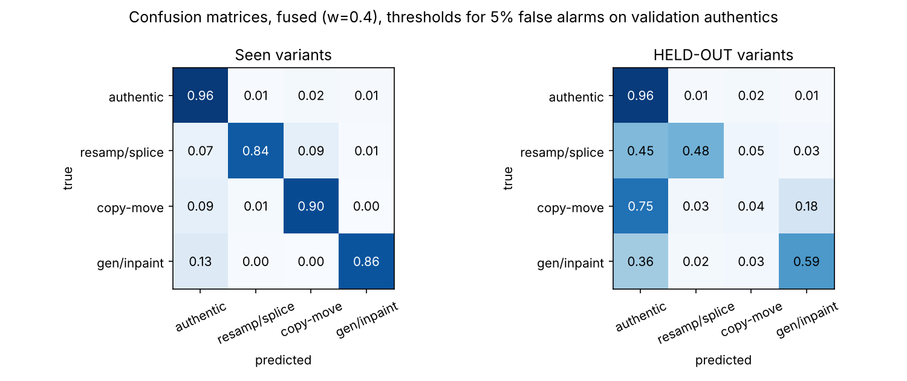
</p>

### Robustness: where the detector breaks

One operation is applied to every one of 600 source patches (authentic and manipulated).

| Operation | Seen in training | False alarms on authentic | Detection |
|---|---|---|---|
| none | yes | 3.5% | 88.0% |
| JPEG q90 | yes | 5.5% | 46.3% |
| JPEG q70 | yes | 3.8% | 31.7% |
| WebP q60 | yes | 7.2% | 34.3% |
| gamma 0.8 | no | 7.8% | 87.8% |
| Gaussian blur 0.6 | no | 100.0% | 100.0% |
| JPEG 2000 r10 | no | 69.3% | 88.5% |

> [!WARNING]
> **Known weak spot.** Gaussian blur and JPEG 2000 on *authentic* patches raise false alarms sharply, because they are
> physically the same low-pass signal as resampling. There is **no separate "globally processed" outcome yet**: a smoothed
> authentic patch is flagged like any manipulation and quarantined for an analyst. That costs a review, not a silently
> released fake, and the integrity axis still proves independently that signed pixels are untouched since signing.

### Trust-layer attack campaign

200 genuine signed products, each attacked in transit by every attack. "Caught" means the ground station returned exactly the expected status.

| Attack | Expected status | Caught |
|---|---|---|
| none (genuine) | `VERIFIED` | 100% |
| inpaint after capture | `PIXELS_ALTERED` | 100% |
| copy-move after capture | `PIXELS_ALTERED` | 100% |
| resample after capture | `PIXELS_ALTERED` | 100% |
| LSB embedding (invisible) | `PIXELS_ALTERED` | 100% |
| date replaced, signature kept | `BAD_SIGNATURE` | 100% |
| date replaced and re-signed with an attacker key | `UNKNOWN_KEY` | 100% |
| hash downgraded to md5 | `WEAK_ALGORITHM` | 100% |
| forged processing step | `CHAIN_BROKEN` | 100% |
| manifest attached to another image | `PIXELS_ALTERED` | 100% |
| replay of a delivered product | `REPLAY` | 100% |
| edit + provenance stripped | `NO_PROVENANCE` | 100% (see below) |

**The last row is not a win.** "100%" only means the verifier correctly reported that *no provenance exists*. Without a manifest only the
content detector can notice: of 200 edited patches whose manifest was removed, 138 were flagged
`SUSPICIOUS` and 62 were released as `UNVERIFIED_NO_TRACES`.

**And the honest limit of the whole design.** Of 200 fakes made *before* signing (a compromised payload), the content detector
flagged 168 and 32 passed as `VERIFIED`. On the other side, 9 of
200 genuine signed products were flagged by the content detector and quarantined for review although their integrity was proven.

### Attack scenarios A to F, end to end

`python -m simulation.run_attack --all --n 20` signs synthetic traffic from the bundled sample patches, attacks it, and feeds it to the real
ground-station code. Every trial first delivers an untouched control product that must be `VERIFIED`, so a scenario can never
pass because the ground station rejects everything.

| ID | What the attacker does | Expected | Result |
|---|---|---|---|
| A1 | erase and fill a region, keep the manifest | `PIXELS_ALTERED` | 20/20 |
| A2 | flip 512 least-significant bits (invisible) | `PIXELS_ALTERED` | 20/20 |
| B1 | change the capture date | `BAD_SIGNATURE` | 20/20 |
| B2 | claim to be the satellite, sign with an own key | `UNKNOWN_KEY` | 20/20 |
| C1 | edit the image and rebuild a matching manifest with an own key | `BAD_SIGNATURE` | 20/20 |
| C2 | algorithm substitution: claim md5 | `WEAK_ALGORITHM` | 20/20 |
| D1 | replay a genuine, already delivered message | `REPLAY` | 20/20 |
| E1 | copy-move, manifest removed | detector flags it | flagged 4/20 |
| E2 | splicing, manifest removed | detector flags it | flagged 2/20 |
| E3 | inpainting, manifest removed | detector flags it | flagged 9/20 |
| E4 | resampling, manifest removed | detector flags it | flagged 19/20 |
| F1 | fake made **before** signing (compromised payload) | integrity `VERIFIED` | `VERIFIED` 20/20; detector flagged 9/20 |

Scenarios A to D are cryptographic guarantees. E1 to F1 have no signature to check, so the result is a measured detection rate on
methods the detector was not trained on, over a small sample.

### Cost

| Measure (one CPU core, no GPU) | Value |
|---|---|
| Feature extraction per patch (p50 / p95) | 21.4 ms / 29.8 ms |
| Full analysis per patch (features + CNN + fusion) | 36.7 ms (27.3 patches/s); 41.5 ms with heatmap |
| Peak memory of the analysis process (incl. PyTorch) | 705 MB |
| Model size (feature model, CNN) | 3601 KB + 304 KB |
| Signing / verification (median) | 0.25 ms / 0.38 ms |
| Signed manifest (one processing record) | 1091 bytes, 17.2% of the PNG it protects |

---

## Quick start

Requirements: Python 3.12 or newer. Docker, Node.js and PHP are only needed for the optional parts.

```bash
git clone https://github.com/aannonymous734-create/pixelproof_ground_station.git
cd pixelproof_ground_station

python -m venv .venv
source .venv/bin/activate                    # Windows PowerShell: .venv\Scripts\Activate.ps1
pip install -r requirements.txt
pip install -r requirements-cnn.txt --index-url https://download.pytorch.org/whl/cpu   # optional: the pixel CNN (CPU wheel)

python -m pytest -q                          # automated tests
python scripts/quick_demo.py                 # ground + attacker + satellite on this machine
```

`quick_demo.py` starts the ground station (API + dashboard, with the attack lab switched on), starts an attacker that tampers with
a random 60% of the messages, lets the satellite sign sample patches and send them *through* the attacker, scores the outcome
against the attacker's own log, and leaves the dashboard open at <http://127.0.0.1:8000>. Use `--no-wait` for a quick check
that stops when done. No dataset download is needed: 30 unmodified official patches ship in [`samples/`](samples/README.md).

### Run only the ground station

```bash
uvicorn pixelproof.api:app --port 8000       # dashboard and API at http://localhost:8000
PIXELPROOF_LAB_MODE=1 uvicorn pixelproof.api:app --port 8000   # also enable the attack-lab endpoints (off by default)
```

### Check imagery from the command line (jury use)

```bash
# Content analysis of every image in a folder, any format or size (tiled, never resized) -> CSV
python -m pixelproof.cli detect --input FOLDER_OF_PATCHES --output predictions.csv
```

The folder is searched recursively (PNG, JPEG, TIFF, WebP, BMP). The CSV has one row per file: `file`, `manipulated`, `type`,
`manipulation_score`, `threshold`, one probability column per class (`p_...`), the number of `tiles` analysed and an `input_note`
(for example a bit-depth conversion). Unreadable files become `error` rows instead of stopping the run.

```bash
# Full two-axis verdict for one image, optionally with its manifest and an evidence heatmap
python -m pixelproof.cli analyse --image patch.png --manifest manifest.json --heatmap evidence.png

# Source side: create demo keys, sign a capture, then verify integrity only
python -m pixelproof.cli keys-init
python -m pixelproof.cli sign   --image patch.png --product-id S2-DEMO-0001 --time 2026-09-01T10:00:00+00:00 --out manifest.json
python -m pixelproof.cli verify --image patch.png --manifest manifest.json
python -m pixelproof.cli fingerprints          # compare these with the other machine, out of band
```

### Run every attack scenario

```bash
python -m simulation.run_attack --list                          # what can be run
python -m simulation.run_attack --scenario image_tampering      # one scenario, with the full story
python -m simulation.run_attack --all --n 20 --out results/attack_runs   # everything, saved as evidence
```

The exit code is 0 only if every *integrity* scenario produced exactly the expected status.

### Dashboard development and tests

```bash
cd frontend
npm install
npm run dev            # Vite dev server, /api is proxied to http://127.0.0.1:8000 (override with PXP_API)
npm run build          # production build into pixelproof/static/app
npm test               # unit tests (Vitest)
npm run test:e2e       # end-to-end tests (Playwright)
```

### Optional sign-in server

Requires PHP 8.2+, Composer and a MySQL database named `backend` (see `backend/.env.example`).

```bash
cd backend
composer install
cp .env.example .env && php artisan key:generate && php artisan jwt:secret
php artisan migrate
php artisan serve --port=8001
```

---

## Attack labs

The same three programs (satellite, attacker, ground station) are deployed in four ways, from an explicit relay to a
**transparent man-in-the-middle** that the satellite does not know about.

| Lab | Attacker | Satellite aware of the attacker? | Status | Evidence |
|---|---|---|---|---|
| **On one machine** (`scripts/quick_demo.py`, `simulation/run_attack.py`) | relay inside the process or on localhost | yes | **run** | `results/attack_runs/` |
| **D1: Docker, explicit relay** (`docker-compose.yml`) | relay container on both networks | yes | **run**: 19 of 19 cryptographic attacks stopped, genuine messages unharmed 20/20 | `results/docker_lab/` |
| **D2: Docker, transparent man-in-the-middle** (`docker-compose.mitm.yml`) | the satellite's router plus one `iptables` DNAT rule | **no**, proven by its own packet capture | **run and verified**: 16 of 16 stopped, genuine unharmed 7/7 | `results/docker_mitm/` (pcap included) |
| **N: Linux network namespaces** (`lab/netns_lab.py`) | router plus DNAT, no containers | no | run in an earlier session: tampering caught 7/7 | `results/lab/` |
| **V: three VirtualBox VMs** (`lab/Vagrantfile`) | Kali router | no | scripts provided and syntax-checked, **never booted by us** | `lab/provision/` |

```bash
# D1: explicit relay, three containers on two isolated networks
docker compose up --build

# D2: transparent man-in-the-middle
docker compose -f docker-compose.mitm.yml up --build --abort-on-container-exit --exit-code-from satellite
python scripts/check_transparency.py          # reads the satellite's own capture
python simulation/score_demo.py --log results/docker_mitm/attacker_log.jsonl --ledger results/docker_mitm/ledger.jsonl
docker compose -f docker-compose.mitm.yml down -v
```

**Why the man-in-the-middle is transparent.** The satellite is configured with *one* address, the ground station's. Its only
route to the ground subnet goes through the attacker container, which forwards packets and adds a standard destination-NAT rule that
hands ground-bound traffic to its tampering relay. There is no ARP spoofing and no packet forging, and the reply is rewritten
back so it appears to come from the ground station. The satellite's capture holds 466 IP packets, all with the ground station as
peer (attacker address in any IP header: False).

**Isolation.** Both bridges have address translation switched off (no internet route), private keys live only in the satellite's
volume, the ground station receives the public registry read-only, and `NET_ADMIN` applies only inside the attacker's own network
namespace. Never point this lab at anything that is not these three containers.

---

## Reproduce every number

Every measured number lives in `results/` and is inserted into the reports and into this README by a script that **refuses to
build if a number cannot be resolved**.

```bash
python scripts/check_numbers.py docs/README.template.md     # every number of this README resolves to a result file
python scripts/render_readme.py                             # regenerate README.md from the template
python scripts/render_latex.py                              # regenerate the LaTeX report (needs pdflatex)
```

To rebuild the results from the official data (tens of minutes on two CPU cores, dominated by feature extraction and CNN training):

```bash
python scripts/download_eurosat.py --out data/eurosat       # official EuroSAT RGB release, checked against the paper's class counts
python scripts/build_features.py --data-dir data/eurosat --out results/features.csv.gz
python scripts/train.py --data-dir data/eurosat --features results/features.csv.gz --overwrite   # replaces the saved model
python scripts/run_attack_campaign.py --data-dir data/eurosat
python scripts/robustness_sweep.py --data-dir data/eurosat
python scripts/heldout_v2.py evaluate --tag current         # checks the frozen set's SHA-256 first
python scripts/evaluate.py --data-dir data/eurosat          # metrics.json, RESULTS.md, figures
```

`train.py` refuses to overwrite the shipped model unless you pass `--overwrite` or write elsewhere (`--models`, `--out`). All
randomness is seeded, every evaluation patch is rebuilt deterministically from (patch id, split, family), and dependency
versions are pinned in `requirements.txt` and `requirements-cnn.txt`. The model card `models/detector.json` records the model's
SHA-256, thresholds and fusion weight, and the dashboard's Station page checks the file against it.

## Report

The Phase 1 report is in [`docs/latex/`](docs/latex/): the PDF
[`PixelProof_Phase1_Report.pdf`](docs/latex/PixelProof_Phase1_Report.pdf), the LaTeX sources (`main.tex` plus one file per section), and the figures.
It covers the threat model, architecture, trust layer, signal processing, detector design and evaluation, the standard scenario and evasion, the
labs, the dashboard, feasibility, a business model with potential partners, and limitations.

---

## API

Served by FastAPI. Limits: 2 MB per image, a decode guard, a per-client rate limit on the analysis endpoints
(`PIXELPROOF_RATE_PER_MIN`, default 120 per minute), and no stack traces or key material in responses (all tested).

| Method and path | Purpose |
|---|---|
| `GET /api/v1/health` | status, model version, detector mode (`features+cnn` or `features`), number of trusted keys |
| `POST /api/v1/ingest` | a live downlink (`image_png_b64`, `manifest`): verify and record, analyse, decide, log |
| `POST /api/v1/analyse` | an analyst upload (multipart image + optional manifest): inspect only, no replay record |
| `GET /api/v1/ledger?limit=` | recent audit-log entries, chain validity and first bad entry |
| `GET /api/v1/stats` | counters computed from the audit log only |
| `GET /api/v1/station` | trusted public keys and fingerprints, trust policy, replay memory, detector mode and model hash |
| `GET /api/v1/registry` | the public-key registry |
| `GET /api/v1/results` | the measured result files (for the dashboard) |
| `GET /api/v1/lab/scenarios`, `POST /api/v1/lab/run`, `GET /api/v1/lab/runs` | attack scenarios (only with `PIXELPROOF_LAB_MODE=1`) |

## Repository layout

```
pixelproof/        ground station: trust layer (provenance.py, ledger.py), detector (features.py, cnn.py, detector.py,
                   calibration.py), verdict.py, service.py, API (api.py), attack engine (integrity_attacks.py, lab.py), CLI
  static/app/      the built dashboard, served by the ground station
frontend/          dashboard source (React, TypeScript, Vite, Tailwind, Three.js)
backend/           optional Laravel sign-in server (JWT in HttpOnly cookies)
simulation/        satellite_node.py, attacker.py, score_demo.py, run_attack.py
lab/               Linux network-namespace lab and the VirtualBox / Vagrant lab with its provisioning scripts
docker-compose.yml, docker-compose.mitm.yml, Dockerfile     the Docker labs
samples/           30 unmodified official EuroSAT patches for the labs, tests and demo
assets/            screenshots used in this README (dashboard pages, sign-in, architecture)
scripts/           download, features, training, evaluation, robustness, held-out sets, campaign, demo, report rendering
models/            detector.joblib (+ model card with SHA-256), pixelnet.pt
models_v1/         the model before our changes, kept for the before/after comparison
results/           measured results as JSON, figures, and the lab evidence
tests/             automated tests
docs/              the LaTeX report (docs/latex), figures, and this README's template
```

## Business model and potential partners

> [!NOTE]
> Everything in this section is a **hypothesis to validate with partners**. No agreement, pilot, customer or price exists yet,
> and no market size is claimed. Nothing in the technical results depends on it.

**Why the need is real.** Tunisia is building up its own Earth-observation capacity: its first governmental satellite, described by the
national mapping and remote-sensing centre (CNCT) as a 6U CubeSat designed for Earth observation, is reported to be in development
([Space in Africa, May 2026](https://spaceinafrica.com/2026/05/19/tunisia-moves-to-develop-its-first-governmental-satellite/)),
and a space association and regional remote-sensing bodies are already active around it. Every new source of imagery is also a new place where provenance
can be lost, and adding signed origin to a ground segment from the start costs far less than retrofitting it after products circulate.

**Business Model Canvas**

| Block | Hypothesis |
|---|---|
| **Customer segments** | operators of EO ground segments and data distribution, including CubeSat programmes; analysts and decision makers using EO in agricultural insurance, water management and disaster response; auditors and verification desks receiving third-party imagery |
| **Value proposition** | prove the origin and integrity of every patch; flag post-capture manipulation with its type and a heatmap; keep "was it signed" and "does it look manipulated" apart; quarantine instead of silent release; runs on a laptop CPU with no hardware to buy; auditable log and honest limits |
| **Channels** | public repository, dashboard, command line and API, workshops with partners, integration guides |
| **Customer relationships** | open-source community, pilots with early adopters, support agreements, training |
| **Revenue streams** | integration and deployment services, support and maintenance subscriptions, training, funded pilots and grants. The code is MIT-licensed, so no licence revenue is assumed |
| **Key resources** | open code and models, evaluation sets with recorded hashes, the attack labs, a team spanning remote sensing, signal processing and computational intelligence |
| **Key activities** | maintain the verifier and the detector, extend to new sensors and bands, red-team and frozen-set evaluation, run pilots and training |
| **Key partners** | see below |
| **Cost structure** | engineering time, security review and key management, test-data curation, CPU-only infrastructure (no GPU, no cloud), training and pilot support |

**Potential partners.** None of them has agreed to anything; every row below is *not yet approached*.

| Potential partner | What they could bring | What PixelProof brings | First step |
|---|---|---|---|
| **TUNSA**, Tunisian Space Association | a non-profit association for space technology in Tunisia: community, events, student and educational EO projects, an existing cooperation agreement with CRTEAN ([source](https://spaceinafrica.com/2024/02/08/tunsa-to-advance-partnership-with-crtean-to-boost-collaborative-efforts/)) | a verification layer for the products of educational and student missions; training for members | present the prototype; offer a pilot on the products of one of their projects |
| **CRTEAN**, Regional Center for Remote Sensing of North African States | remote-sensing expertise; access to real satellite imagery for validation | a provenance and integrity check for imagery it distributes or trains on | request a small set of real products to test the detector beyond EuroSAT |
| **CNCT**, national mapping and remote-sensing centre | technical secretariat of the National Commission of Outer Space Affairs; remote-sensing studies on water and disaster management | signing at the source and a ground-side verifier designed into national EO products from the start | discuss where a signing point and a key registry would sit in a ground segment |
| Agricultural insurers, water and agriculture authorities, civil-protection agencies | the decision contexts where a doctored patch has a cost | flagging and quarantine before imagery enters a claim, a monitoring product or a response | ask what false-alarm rate a human review desk can tolerate; pilot on one product |
| Universities and IEEE chapters (GRSS, SPS, CIS) | independent evaluation, new datasets, student contributors | a documented, reproducible testbed with frozen held-out sets | share the evaluation protocol for independent scoring |
| CubeSat and ground-station operators | the places where signing keys and processing steps actually live | a software trust anchor with an upgrade path to SoftHSM2 or a TPM | agree a key-handling and registry procedure |

**Roadmap with partners.** (1) Pilot on a small, friendly source: sign the products of one educational mission and run the verifier and dashboard on them.
(2) Validate on real imagery: re-measure the false-alarm budget on real Sentinel-2 or CubeSat products, because EuroSAT is single-JPEG and 8-bit.
(3) Move toward users: take the quarantine and audit workflow to an insurer, a water authority or a disaster-response desk, and let their tolerance for false alarms set the threshold.

---

## Limitations and roadmap

**Known limitations**

- **Smoothing of authentic patches** (blur, JPEG 2000) raises false alarms sharply; the patch is quarantined for review. At JPEG 2000 rate 30 the false-alarm rate is 87.3%.
- **Held-out splicing and copy-move** remain the hardest families: on held-out v1 splicing is detected at 18.1% and copy-move at 25.3%.
- **Localisation** is weak except for copy-move (mean IoU 0.31; 0.11 for splicing, 0.02 for inpainting). Classification is reliable; precise location is future work.
- **No fully generated patches** (GAN or diffusion) exist in the official data; the "generated" class is approximated by inpainting and texture synthesis and is labelled as such.
- **Integrity cannot judge content signed by a compromised source** (scenario F1).
- **The audit log is tamper-evident, not tamper-proof**, and the ground-station API has no authentication or TLS in the isolated lab. The optional sign-in protects the dashboard, and its cookies are not flagged `Secure` on plain HTTP.
- **Lab shortcuts:** the processor key is created next to the satellite key, so one node can sign the processing step; a real deployment keeps it on the ground system.
- **8-bit RGB only:** multispectral and 16-bit inputs are converted, but their false-alarm rate is **not measured**.

**Roadmap**

1. A calibrated "globally processed / inconclusive" outcome across the whole smoothing range.
2. Adopt a retrained candidate detector (measured in the report, not shipped) once its false alarms on re-encoded authentic patches are back within budget.
3. RANSAC geometric-consistency grouping for copy-move and finer splice localisation.
4. Training and testing on public GAN or diffusion satellite fakes.
5. The 13-band EuroSAT-MS release: inter-band consistency, since an RGB edit rarely updates the infrared bands consistently.
6. Authentication and TLS on the ingest API, and an external anchor for the audit log.
7. Pilots with prospective partners (the report lists a Business Model Canvas and candidate partners, all explicitly unvalidated hypotheses).

## References, licence and data

- P. Helber et al., *EuroSAT: a novel dataset and deep learning benchmark for land use and land cover classification*, IEEE JSTARS, 2019.
- A. C. Popescu and H. Farid, *Exposing digital forgeries by detecting traces of resampling*, IEEE TSP, 2005.
- J. Fridrich et al., *Detection of copy-move forgery in digital images*, DFRWS, 2003; J. Fridrich and J. Kodovsky, *Rich models for steganalysis of digital images*, IEEE TIFS, 2012.
- B. Bayar and M. C. Stamm, *Constrained convolutional neural networks for image manipulation detection*, IEEE TIFS, 2018.
- S. Josefsson and I. Liusvaara, *Edwards-Curve Digital Signature Algorithm (EdDSA)*, RFC 8032; NIST, *Secure Hash Standard*, FIPS 180-4.
- C2PA, *Content Credentials technical specification*, 2024 (the same idea of a signed claim plus signed processing history, restricted to what one ground station can verify offline).

Code: [MIT licence](LICENSE). Data: EuroSAT (MIT) under the Copernicus Sentinel data terms.

<sub>The numbers in this README are generated from `results/` by `scripts/render_readme.py`; edit `docs/README.template.md`, not this file.</sub>
